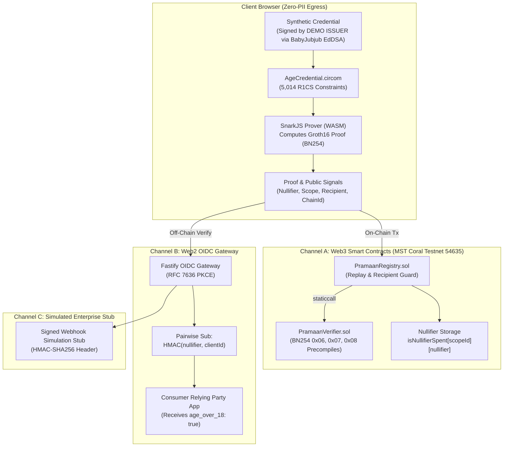

# Pramaan-ZK — Privacy-Preserving Zero-Knowledge Attribute Verification

> **Honesty Notice:** *Synthetic testnet credential. Real Aadhaar QR support is future work (milestone M2).*  
> This system proves that an attribute statement holds (e.g. *credential holder age &ge; 18*); it **never** claims "identity verified by government". All write interactions remain strictly on testnets.

---

## 1. What is Pramaan-ZK?

**Pramaan-ZK** is a zero-knowledge attribute verification protocol designed for the **MST Blockchain** ecosystem. It enables individuals to prove statements about their credentials (currently **age &ge; 18**) purely client-side using **Groth16 zk-SNARKs** over the BN254 elliptic curve without leaking their date of birth, name, photo, or government identity number.

Proofs can be verified across three distinct channels:
1. **Channel A (Web3):** Smart contracts on MST Coral Testnet (`PramaanVerifier.sol` and `PramaanRegistry.sol`) verifying Groth16 proofs via EVM precompiles (`0x06`, `0x07`, `0x08`) and tracking scoped nullifiers.
2. **Channel B (Web2):** An OIDC-lite gateway issuing signed JWT ID tokens with pairwise pseudonymous subjects (`sub = HMAC(nullifier, clientId)`) via PKCE authorization code flow.
3. **Channel C (Government/DPI):** A signed-webhook simulation stub clearly marked as an operational prototype (`SIMULATION — NOT A GOVERNMENT INTEGRATION`).

---

## 2. System Architecture



---

## 3. Transparency Table: What is Real, Mocked, & Unverified

| Feature / Layer | Implementation Status | Evidence / Notes |
|---|---|---|
| **MST Coral Testnet Contracts** | `REAL & DEPLOYED` | `PramaanVerifier` (`0xed8fe3...`), `PramaanRegistry` (`0x8c182a...`), and `PrecompileProbe` (`0x94b9b5...`) deployed on Chain 54635. |
| **BN254 EVM Precompiles** | `REAL & MEASURED` | Measured on live Coral Testnet: `0x06` (552 gas), `0x07` (6,396 gas), `0x08` (113,447 gas). |
| **On-Chain Gas Consumption** | `REAL & MEASURED` | `PramaanVerifier.verifyProof`: 259,208 gas; `PramaanRegistry.verifyAndRecord`: 288,906 gas on MST Coral Testnet. |
| **Circuit & Prover** | `REAL & VERIFIED` | `AgeCredential.circom` compiles to 5,014 constraints; snarkjs generates valid Groth16 proofs client-side in ~636ms (desktop unthrottled). |
| **On-Chain Negative Paths** | `REAL & TESTED` | 7/7 negative paths verified on Coral testnet: tampered proof, unregistered issuer, chain mismatch, recipient mismatch, nullifier spent (replay), contract paused, tampered public signal. |
| **Fastify API & OIDC-Lite** | `REAL & TESTED` | Fastify + `jose` issuing ES256 signed ID tokens with PKCE code verification. |
| **Credential Container** | `SYNTHETIC (DEMO)` | EdDSA-Poseidon signature over BabyJubjub curve issued by **DEMO ISSUER**. Real Aadhaar RSA-in-circuit is milestone M2. |
| **Nullifier Formula** | `UNREVIEWED (DEMO)` | `nullifier = Poseidon(credentialSecret, scopeId)`. Unreviewed primitive; not formally audited. |
| **Ceremony** | `DEV-ONLY` | Dev-only Powers of Tau (pot13) 1-contributor setup. Production multi-party ceremony required before release. |
| **Government Channel** | `SIMULATED STUB` | Signed webhook simulation stub. Not a live government integration. |
| **Contract Source on Explorer** | `UNVERIFIED` | Bytecode deployed and live on Coral Blockscout, but source code is not yet formally verified via explorer API. |
| **Contract Ownership** | `EOA SINGLE KEY` | Deployed and owned by single developer EOA (`0xded55a728b4ef6e91643ea947699c36e49cffefa`); multisig/timelock not yet configured. |

---

## 4. UI Architecture & Design System

The frontend is built on a **Cinematic Liquid-Glass Design System**:
- **Canvas:** Pure OLED Black (`#000000`).
- **Materials:** Multi-layer liquid glass cards (`.liquid-glass`) with luminosity blending, backdrop blur, inset specular highlights, and 1.4px gradient masked borders.
- **Typography:** **Inter** font family loaded with geometric tracking.
- **Operational Modules:**
  - **Overview:** Live network telemetry (5,014 constraints, 288k gas, block progression) and contract cards with direct links to Coral Blockscout.
  - **Prover Studio:** 3-step proof lifecycle (Synthetic Attestation &rarr; Local In-Browser WASM Proof &rarr; Coral Settlement).
  - **Registry Explorer:** Live interactive on-chain query tool for nullifier spent status and issuer authority.
  - **Audit Log:** On-chain transaction receipt auditor decoding `ProofVerifiedAndRecorded` event logs and gas metrics.
  - **Coral Explorer:** Direct link to block explorer.

---

## 5. Quickstart & Verification Commands

### Prerequisites
- **Node.js:** `v22.23.1` (or `>= 20.x`)
- **pnpm:** `11.13.0` (or `>= 9.x`)
- **Circom:** `v2.1.8` (for compiling circuits)

### Installation
```bash
# Clone repository
git clone https://github.com/Shantanu112-bd/Zentity.git
cd Zentity

# Install dependencies
pnpm install
```

### Run Full Test Suite
```bash
# Runs 58 automated unit, circuit, smart contract, and zero-egress tests
pnpm test
```

### Preflight Live Network Check
```bash
# Queries live MST Coral Testnet RPC (54635)
pnpm run preflight:coral
```

### Start Development Server
```bash
# Runs backend gateway (:3001) and Vite React app (:5173) concurrently
pnpm run dev
```
Open **http://localhost:5173** in your browser.

---

## 6. Known Limitations & Residual Risks

1. **Synthetic Credential:** This MVP uses EdDSA-Poseidon signatures over BabyJubjub. Real Aadhaar QR code verification (requiring 2048-bit RSA-SHA256 signature verification in Circom) is deferred to Milestone M2.
2. **Unreviewed Nullifier Derivation:** The demo formula `nullifier = Poseidon(credentialSecret, scopeId)` has not undergone formal cryptanalytic audit.
3. **DEV-ONLY Trusted Setup:** The Powers of Tau (pot13) ceremony was conducted locally for development and is not secure for production value transfer.
4. **Stolen-QR Threat:** Without hardware secure-enclave device binding, a stolen QR credential can be proven by an unauthorized holder.
5. **Contract Custody:** Contracts are currently owned by a single deployer EOA rather than a multi-sig / timelock.
6. **In-Memory Volatile Persistence:** Backend OIDC auth codes, nonces, and challenge tokens are held in in-memory Maps and reset on process restart.

---

## 7. License
GPL-3.0 / MIT.
