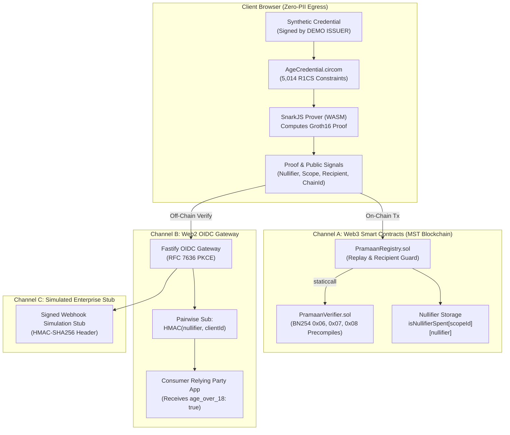

# Pramaan-ZK (Zentity) — Privacy-Preserving Attribute Verification

> **Honesty Notice:** *Synthetic credential. Real Aadhaar QR support is future work (milestone M2).*  
> This system proves that an attribute statement holds (e.g. *credential holder age &ge; 18*); it **never** claims "identity verified by government".

---

## 1. What is Pramaan-ZK?

**Pramaan-ZK** is a zero-knowledge attribute verification system designed for the **MST Blockchain** ecosystem. It enables individuals to prove statements about their credentials (initially **age &ge; 18**) purely client-side using **Groth16 zk-SNARKs** over the BN254 elliptic curve without leaking their birth date, name, photo, or government identity number.

Proofs can be verified across three distinct channels:
1. **Channel A (Web3):** Smart contracts on MST Blockchain (`PramaanVerifier.sol` and `PramaanRegistry.sol`) verifying Groth16 proofs via EVM precompiles (`0x06`, `0x07`, `0x08`) and tracking scoped nullifiers.
2. **Channel B (Web2):** An OIDC-lite gateway issuing signed JWT ID tokens with pairwise pseudonymous subjects (`sub = HMAC(nullifier, clientId)`) via PKCE authorization code flow.
3. **Channel C (Government/DPI):** A signed-webhook simulation stub clearly marked as an operational prototype.

---

## 2. System Architecture



---

## 3. Transparency Table: What is Real, Mocked, & Unverified

| Feature / Layer | Implementation Status | Evidence / Notes |
|---|---|---|
| **MST Coral Testnet Contracts** | `REAL & DEPLOYED` | `PramaanVerifier` (`0xed8fe3...`), `PramaanRegistry` (`0x8c182a...`), and `PrecompileProbe` (`0x94b9b5...`) deployed on Chain 54635. |
| **BN254 EVM Precompiles** | `REAL & MEASURED` | Measured on live Coral Testnet: 0x06 (552 gas), 0x07 (6,396 gas), 0x08 (113,447 gas). |
| **Circuit & Prover** | `REAL & VERIFIED` | `AgeCredential.circom` compiles to 5,014 constraints; snarkjs generates valid Groth16 proofs in 636 ms on desktop (unthrottled). |
| **On-Chain Negative Paths** | `REAL & TESTED` | 7/7 negative paths verified on Coral testnet: tampered proof, wrong issuer, chain mismatch, recipient mismatch, replay, pause, tampered date. |
| **Fastify API & OIDC-Lite** | `REAL & TESTED` | Fastify + `jose` issuing ES256 signed ID tokens with PKCE code verification. |
| **Credential Container** | `SYNTHETIC (DEMO)` | EdDSA-Poseidon signature over BabyJubjub issued by **DEMO ISSUER**. Real Aadhaar RSA-in-circuit is milestone M2. |
| **Nullifier Formula** | `UNREVIEWED (DEMO)` | `nullifier = Poseidon(credentialSecret, scopeId)`. Unreviewed primitive; not formally audited. |
| **Ceremony** | `DEV-ONLY` | Dev-only Powers of Tau (pot13) ceremony. Production ceremony required before release. |
| **Government Channel** | `SIMULATED STUB` | Signed webhook simulation stub. Not a live government integration. |
| **Mobile Hardware Proving** | `UNVERIFIED` | Client proving benchmarks measured on desktop (macOS arm64); mobile device profiling is unverified. |

---

## 4. UI Brand, Typography, & Palette Choices

- **Distinctive Typeface Pair:**
  - *Headings:* **Syne** (geometric, bold, technical character).
  - *Body & UI:* **Inter** (neutral, high legibility across mobile & desktop).
  - *Data & Hashes:* **JetBrains Mono** (clear distinction for cryptographic hex & nullifiers).
- **Restrained Dark Palette:**
  - *Ground:* `#08090d` / `#090a0f` (deep basalt).
  - *Surfaces:* Glassmorphic slate (`rgba(15, 23, 42, 0.65)` with backdrop blur).
  - *Primary Accent:* Cyan `#00f2fe` to Emerald `#10b981` gradient (connotes mathematical precision & verified attributes).
  - *Status Matrix:* Emerald (Real On-Chain), Cyan (Off-Chain Verified), Amber (Synthetic Credential), Purple (Simulated Stub).
- **Mechanics:** Canvas-rendered "Proof Gate" portal that procedurally expands aperture rings and particles only upon valid cryptographic resolution.

---

## 5. Quickstart & Exact Run Commands

### Prerequisites
- **Node.js:** `v22.23.1` (or `>= 20.x`)
- **pnpm:** `11.13.0` (or `>= 9.x`)
- **Circom:** `v2.1.8` (for compiling circuits)

### Installation
```bash
# Clone repository
git clone https://github.com/Shantanu112-bd/Zentity.git
cd Zentity

# Install all dependencies
pnpm install
```

### Run Full Test Suite
```bash
# Runs 32 automated unit, circuit, smart contract, and zero-egress tests
pnpm test
```

### Start Development Environment
```bash
# Starts both Fastify backend (port 3001) and Vite React frontend (port 5173)
pnpm dev
```
Open **http://localhost:5173** in your browser.

---

## 6. Three-Minute Demo Walkthrough Script

### Minute 1: The Proof Gate & Client Proving
1. Navigate to **http://localhost:5173**.
2. Observe the procedural **Proof Gate Portal** with mouse parallax and preloader counter.
3. Click **"Begin Proof"** (or open `/prove`).
4. Keep the preset on **"Adult Credential (Age 25)"** and click **"Generate Proof"**.
5. Watch the step progress bar: *Preparing Inputs &rarr; Computing Witness &rarr; Groth16 Proving*.
6. Review the output: public signals bound to `scopeId` and `nullifier` without any date of birth in the witness.
7. Click **"Minor Credential (Age 16)"** and press **"Generate Proof"**: notice the immediate **constraint rejection** (`LessEqThan(64)` fails), demonstrating negative verification.

### Minute 2: Web2 OIDC-Lite Consumer Login
1. Click **"Web2 Relying Party"** in the navigation bar (`/relying-party`).
2. Notice the "Age-Restricted Storefront" prompt.
3. Click **"Authorize with Pramaan-ZK"**.
4. The user is redirected to the OIDC gateway, executes PKCE authorization code exchange, and redirects back.
5. Inspect the resulting session:
   - Received claim: `age_over_18: true`.
   - Pairwise subject `sub`: a non-correlatable HMAC identifier distinct from any other relying party.
   - Zero name or government identity exposed.

### Minute 3: Web3 Registry & On-Chain Replay Guard
1. Click **"Web3 Gate"** in the navigation bar (`/dapp`).
2. Query `PramaanRegistry.isNullifierSpent` with a scope and nullifier.
3. Observe how nullifiers prevent double-spending / Sybil attacks within the same scope while enabling cross-app pseudonymity across different scopes.

---

## 7. Known Limitations & Residual Risks

1. **Synthetic Credential:** This MVP uses EdDSA-Poseidon signatures over BabyJubjub. Real Aadhaar QR code verification (requiring 2048-bit RSA-SHA256 signature verification in Circom) is deferred to Milestone M2.
2. **Unreviewed Nullifier Derivation:** The demo formula `nullifier = Poseidon(credentialSecret, scopeId)` has not undergone formal cryptanalytic audit.
3. **DEV-ONLY Trusted Setup:** The Powers of Tau (pot13) ceremony was conducted locally for development and is not secure for production value transfer.
4. **Stolen-QR Threat:** Without hardware secure-enclave device binding, a stolen QR credential can be proven by an unauthorized holder. Device-bound key attestation is scheduled for Milestone M4.
5. **Legacy Testnet Deprecation:** MST Legacy Testnet (`91562037`) operates until January 31, 2027. Authoritative configuration for MST Coral Testnet remains an open dependency (Blocker B-01).
6. **Regulatory Compliance:** Offline zero-knowledge verification against Indian Digital Personal Data Protection (DPDP) Act requirements is pending formal legal opinion (Blocker B-06).

---

## 8. License
GPL-3.0 / MIT. See `LICENSE` for details.
