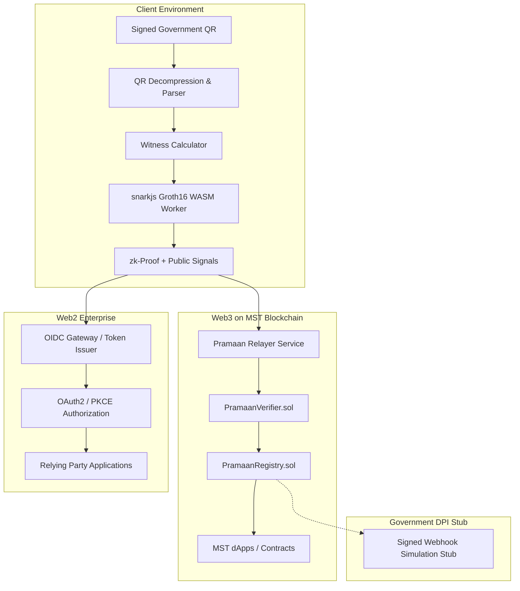

# docs/ARCHITECTURE.md — System Architecture

**STATUS: SKELETON** · **Created:** 2026-10-28

## 1. High-Level Architecture Overview

## 2. Component Definitions
- **Client Proving Engine (`packages/client`):** Executes in a dedicated Web Worker on the user's browser or mobile device. Generates witness and Groth16 proof using zero-knowledge circuits without transmitting credentials over the network.
- **On-Chain Verifier (`contracts/PramaanVerifier.sol`):** Cryptographic contract verifying Groth16 pairings on MST Blockchain using BN254 precompiles (`0x06`, `0x07`, `0x08`).
- **State Registry (`contracts/PramaanRegistry.sol`):** Tracks scope-isolated nullifiers, manages active and revoked issuer public key hashes, enforces anti-replay, and handles governance roles.
- **Gas Relayer (`backend/relayer`):** Facilitates gasless submissions for users, abstracting MST native gas tokens (`tMSTC`) via KMS-backed transaction signing with strict idempotency and quota management.
- **OIDC Gateway (`backend/gateway`):** Web2 OpenID Connect identity provider that verifies proofs off-chain via snarkjs and issues scoped, pairwise pseudonymous JSON Web Tokens (`sub`) to registered clients.
- **Government DPI Webhook Stub (`backend/gov-stub`):** Explicitly simulated webhook emitter demonstrating how government/registry observers could ingest event logs.

